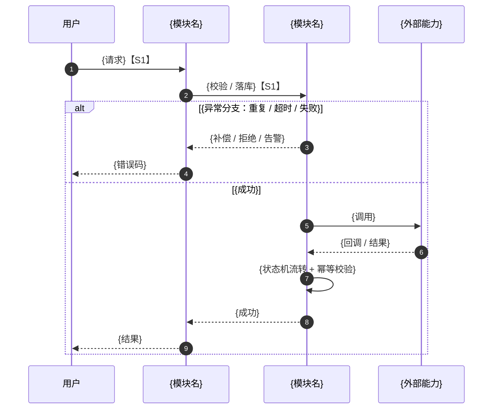

# D{n} {批次名} 技术方案（覆盖 S1–S{m}）

| 项目 | 内容 |
|-|-|
| 需求来源 | [{PRD 标题} · {链接}] |
| 所含故事 | [{S1 故事名}、{S2 故事名}、{S3 故事名}] |
| 适用商家 | [{店铺名称}：微商城单店 / 连锁] |

> **阅读顺序建议**：先看结论摘要和 2.1 / 2.2 确认边界，再看能力核验与数据模型（重点章节 + 独立 DDL 文件），最后看时序图与风险项。

---

## 结论摘要（TL;DR）

**做什么**：

[一段话：这批故事交付什么，用户/商家能感知到什么变化]

**关键结论**：

[技术路线、关键取舍、依赖的外部能力结论。30 秒内能让评审判断要不要继续读]

**明确不做**：

[与 2.2 一致，避免评审误解范围]

## 需求理解与范围

### 2.1 PRD 需求拆解（RFC）

> 填写规则：每条需求必须能回查到 PRD 的“标题 + 行号”。编号（R1、R2…）只是文档内索引，不能替代行号。一个故事至少一行；跨故事共享的需求写清归属。

| 编号 | 故事 | PRD 原文定位（标题 · 行号） | 需求 | 端 | 技术落点 |
|-|-|-|-|-|-|
| R1 | S1 | {标题} · L{行号} | | | |
| R2 | S1 | {标题} · L{行号} | | | |
| R3 | S2 | {标题} · L{行号} | | | |

### 2.2 范围边界

**明确要做**：

-

**明确不做**：

-

**依赖但不属于本文范围**：

-

### 2.3 需求澄清与确认项

> 填写规则：PRD 里模糊、矛盾、缺数据的地方集中在这里。写清找谁确认、何时确认、不确认会影响什么；不要自己补设定。

| # | 待确认问题 | 影响的故事 / 章节 | 找谁确认 | 截止时间 | 不确认的后果 |
|-|-|-|-|-|-|
| C1 | | | | | |

## 能力核验（关键事实）

> 填写规则：方案依赖的每一个有赞能力、三方能力逐条核验。结论只能是 **可用 / 受限 / 不可用 / 待确认**；没有依据链接的，一律算“待确认”。这一节必须在总体架构之前完成。

| # | 能力 / 接口 | 结论 | 验证方式 | 依据链接 | 备注 |
|-|-|-|-|-|-|
| V1 | | 可用 / 受限 / 不可用 / 待确认 | | | |

## 总体架构

### 4.1 职责模块

> 填写规则：只列本方案涉及的模块；模块编号（M1…Mn）在本文内稳定，时序图参与者必须能对上。职责里用一句话写清“不负责什么”，不单列一列。

| 模块编号 | 模块 | Service / 类命名 | 职责 | 关键设计点 | 决策 |
|-|-|-|-|-|-|
| M1 | {业务模块名} | `{XxxService}` | {做什么}；不负责：{不做什么} | | |
| M2 | {业务模块名} | `{XxxService}` | {做什么}；不负责：{不做什么} | | |

## 数据模型设计（重点章节）

> 独立 DDL 文件：`D{n}-schema.sql`（与本方案同目录）。
> 本文引用 DDL 段号（如 `§DDL-1`、`§DDL-2`），段号与 SQL 文件里的注释一致。
> 工作方式：先让 AI 出完整 DDL 草稿，再按三刀修剪——命名偏好、类型规范、业务字段精减。金额用分（bigint），时间用 `datetime(3)`，主键 / 租户 / 软删 / 索引命名统一。

| 表名 | 用途 | 所属故事 | 新增 / 改造 | DDL 段号 | 关键约束 |
|-|-|-|-|-|-|
| `{table_name}` | | S1 | 新增 | §DDL-1 | |

表 SQL（每张表一个 `§DDL-n` 段，与 `D{n}-schema.sql` 保持一致；以下代码块必须完整，不能只写字段清单）：

```sql
-- §DDL-1 {table_name}
CREATE TABLE `{table_name}` (
  `id` bigint NOT NULL AUTO_INCREMENT COMMENT '主键',
  `tenant_id` bigint NOT NULL COMMENT '租户 ID',
  `biz_no` varchar(64) NOT NULL COMMENT '业务单号',
  `status` varchar(32) NOT NULL COMMENT '状态：{枚举值说明}',
  `amount` bigint NOT NULL DEFAULT 0 COMMENT '金额，单位：分',
  `idempotency_key` varchar(64) NOT NULL COMMENT '幂等键',
  `gmt_create` datetime(3) NOT NULL DEFAULT CURRENT_TIMESTAMP(3) COMMENT '创建时间',
  `gmt_modified` datetime(3) NOT NULL DEFAULT CURRENT_TIMESTAMP(3) ON UPDATE CURRENT_TIMESTAMP(3) COMMENT '更新时间',
  `is_deleted` tinyint NOT NULL DEFAULT 0 COMMENT '是否删除：0 否，1 是',
  PRIMARY KEY (`id`),
  UNIQUE KEY `uk_tenant_biz_no` (`tenant_id`, `biz_no`),
  UNIQUE KEY `uk_tenant_idempotency_key` (`tenant_id`, `idempotency_key`),
  KEY `idx_tenant_status` (`tenant_id`, `status`)
) ENGINE=InnoDB DEFAULT CHARSET=utf8mb4 COMMENT='{表说明}';
```

状态机 / 枚举 / 幂等约定（与上面的 DDL 注释一致）：

## 接口设计

> 填写规则：共享接口在首次出现的位置写全，其他位置只写“复用 B1”。故事编号和“首次定义 / 复用”写进说明列，例如 `【S1】首次定义：...`。

| # | 方法 | 路径 | 说明 |
|-|-|-|-|
| B1 | POST | `/api/...` | 【S1】首次定义：... |
| B2 | POST | `/api/...` | 【S2】复用 B1：... |

重点接口请求 / 响应示例：

```json
{
  "request": {},
  "response": {}
}
```

## 核心链路时序图

> 填写规则：这一节是技术密度下限，不是示意图。必须把 **并发、幂等、状态机、异常补偿** 四件事落到图上：锁粒度、重复请求、超时 / 重试、回调验签、金额校验、失败回滚、重复支付、告警。只画 happy path 视为没写完。
> 参与者与 4.1 的模块编号对应；节点标注所属故事 `【S1】`。



## 风险项

> 填写规则：这是“后果登记”，不是“未知清单”。写清这个功能会带来什么兼容问题、异常兜底、技术债、运营成本；标注归属故事与是否阻塞上线。

| # | 风险 / 后果 | 归属故事 | 是否阻塞 | 应对 / 兜底 |
|-|-|-|-|-|
| K1 | | S1 | 是 / 否 | |

## 附录 B：本方案引用的官方文档

| # | 文档 / 接口 | 用途 | 链接 |
|-|-|-|-|
| 1 | | | |
